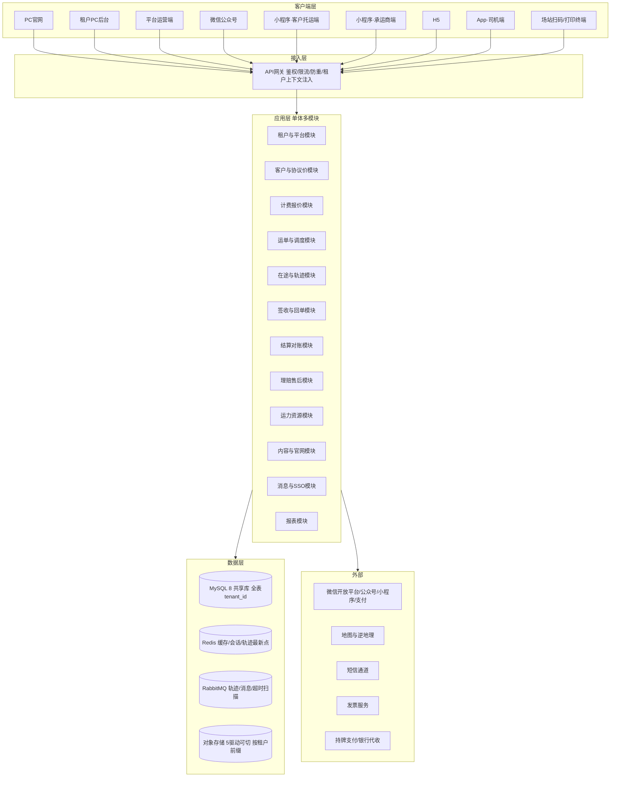
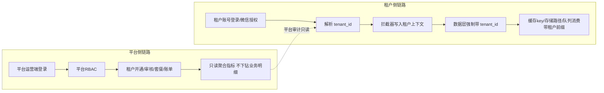

# 物流货运 数字化多端运营平台 PRD

> 品牌背景：区域型综合物流企业（示例口径，落地时按客户实际替换），业务覆盖「零担专线 + 整车包车 + 同城配送」三类，自有车队与外协运力并行；上游客户以制造业工厂、批发商、电商仓为主，下游收货方为经销商、门店与终端客户。收入结构为运费（现结/到付/月结）+ 增值服务（装卸、上楼、保险、代收货款、回单）；成本结构为自有车固定成本 + 外协运费 + 油费过路费 + 场站与人力。
> 项目名称：物流货运数字化多端运营平台（SaaS 版，多租户）
> 产品矩阵：平台运营端（SaaS 控制台） + 租户 PC 管理后台 + PC 品牌官网（询价与轨迹查询） + 微信服务号（11 子页） + 小程序·客户托运端 + 小程序·承运商端 + 移动端 H5（询价分享/电子回单） + App·司机端（Flutter，深度作业）
> 上线模式：一次性完整上线，不分一期二期
> 存储方案：抽象对象存储驱动层，后台可视化切换（本地磁盘 / AWS S3 / 阿里云 OSS / 腾讯云 COS / MinIO），运单照片、回单、签名图、资质文件全部入选中存储
> 架构说明：一后端多端壳，前后端分离；RBAC 多角色权限、全操作审计、UnionID 会员互通、多语言 i18n、系统参数可视化、菜单可视化、富文本 CMS、消息配置（4 通道）、SSO 单点登录、多租户隔离
> 版本：V1.0（2026-11-14）

---

## 一、核心约束（物流行业合规红线，代码强制约束）

1. **经营资质约束**：平台仅服务具备《道路运输经营许可证》的承运主体；租户开通时须上传许可证、营业执照、法人证件，平台端审核通过后方可开单。未通过审核的租户只能浏览后台，不能生成运单。
2. **网络货运边界**：本平台按「自有运力 + 外协运力撮合」设计，**不做无车承运人资金结算池**；如租户实际开展网络货运业务，须另行取得《网络平台道路货物运输经营许可证》，并在平台端租户档案标记「网络货运模式」，该模式下运费流水须与银行存管/持牌支付通道直连，平台只做信息与对账，不经手资金。
3. **运力资质校验**：车辆须有《道路运输证》且在有效期内；驾驶员须有对应准驾车型驾驶证与《道路运输从业人员从业资格证》；两者任一过期，调度派车时阻断并给出中文原因（「车辆道路运输证已于 2026-10-30 到期」）。
4. **危险品特例**：默认不承接危险品、易燃易爆、活体动物、枪支弹药、走私货物。下单时按「禁运品关键词库 + 类目勾选」双重校验，命中即阻断并提示。租户如取得危险品运输资质，可在后台开启「危险品运输」开关，开启后强制校验车辆危运资质与押运员。
5. **实名与货物安全**：寄件人、收件人手机号加密存储、列表脱敏；运单货物明细必填，禁止空泛填写「配件」；开箱验视记录与货物照片为必留证据。
6. **代收货款合规**：代收货款不做资金池沉淀，走持牌支付通道或银行代收直连；平台仅记录应收应付与结算状态，账目与流水双向可核。
7. **发票合规**：运费发票类型（增值税专用发票 / 普通发票 / 电子普票）由客户档案决定，开票信息与合同主体一致；开票金额不得超过已确认对账金额。
8. **数据留存**：运单、轨迹、回单、结算、理赔记录留存不少于 3 年；轨迹与操作日志不可物理删除，只允许归档。
9. **个人信息保护**：收货人信息仅对履约必需角色可见（调度、司机、客服）；导出行为必须留痕并记录用途。
10. **价格透明**：报价须给出计费明细（首重/续重、体积重、里程、车型、装卸、上楼、保险、代收手续费），禁止只给总价；实际重量体积与申报不符时须走「差异改价审批」，不得静默加价。

---

## 二、架构设计

### 2.1 需求摘要

面向「物流公司租户」，把一条货运业务从询价到复购回访全链路口径统一到一套系统：客户端解决「报价不确定、进度看不见、对账靠微信」，调度端解决「派车靠电话、空驶高、外协对账乱」，司机端解决「纸质回单丢失、异常上报无门」，财务端解决「应收应付两本账、月结对账耗时」，管理层解决「线路盈亏算不清、时效达成无据」。

#### 2.1.1 按端功能摘要

| 端 | 核心职责 | 关键页面/能力 |
|---|---|---|
| 平台运营端 | 管租户不管业务 | 租户开通与审核、套餐与席位、账单、平台审计、资质档案审核、平台公告 |
| 租户 PC 后台 | 管全部业务 | 询价报价、客户与协议价、托运单、调度派车、在途跟踪、签收回单、应收应付、对账开票、理赔、车辆司机、承运商、报表、系统配置 |
| PC 官网 | 引流与自助 | 服务介绍、在线询价、运单轨迹查询、网点查询、企业月结申请、加盟合作 |
| 微信服务号 | 触达与留存 | 11 子页运营管理、模板消息全节点通知、菜单、素材、粉丝、数据 |
| 小程序·客户托运端 | 客户自助 | 查价、下单委托、支付、轨迹、电子回单、对账单、发票申请、理赔报案、常用地址与联系人 |
| 小程序·承运商端 | 外协运力 | 接单、派车、提货上报、在途上报、回单上传、应付对账、资质到期提醒 |
| H5 | 分享与兜底 | 询价结果分享、电子回单分享、司机免安装网页兜底 |
| App·司机端 | 一线作业 | 接单、导航、签到提货、称重量方、装车拍照、节点上报、异常上报、签收签名、回单拍照、离线缓存 |

### 2.2 非功能需求（量化阈值，验收按此打勾）

| 类别 | 指标 | 阈值 |
|---|---|---|
| 性能 | 询价报价接口 P95 | ≤ 800ms（含计费规则计算与协议价匹配） |
| 性能 | 运单列表首屏 | ≤ 1.2s（1000 条分页，按租户过滤） |
| 性能 | 轨迹点写入 | 单车 ≤ 30s 一次，单租户峰值 2000 台车不丢点 |
| 性能 | 并发 | 支持 200 并发下单，错误率 < 0.5% |
| 可用性 | 核心服务可用性 | ≥ 99.5%（月停机 ≤ 3.6 小时） |
| 可用性 | 消息推送成功率 | ≥ 98%，失败自动重试 3 次并落库 |
| 一致性 | 运单-派车单-结算单 | 金额与状态强一致，日终对账差异为 0 |
| 安全 | 接口鉴权 | 全部业务接口需登录态 + 租户上下文，越权返回 403 |
| 安全 | 敏感数据 | 手机号、身份证加密存储；导出需二次确认并留痕 |
| 数据 | 备份 | 每日全量 + 每小时增量，保留 30 天，恢复演练 ≤ 4 小时 |
| 兼容 | 端适配 | Chrome/Edge/Safari 最新两个版本；小程序基础库 ≥ 2.20；App Android 8.0+ / iOS 13+ |
| 可维护 | 配置化率 | 计费规则、字典、菜单、消息模板、存储驱动全部后台可配，改配置不发版 |

### 2.3 架构图（一后端多端壳）

### 2.4 多租户两条链路

### 2.5 核心数据流

**正常流（一条零担专线单）**

1. 客户端查价：客户选线路与货物参数 → 计费引擎匹配（协议价 > 线路标准价 > 默认规则）→ 返回明细报价（基础运费 + 燃油附加 + 装卸 + 上楼 + 保险 + 代收手续费）。
2. 下单委托：生成运单号 `YH+租户号+日期+4位序号` → 校验必填与禁运品 → 按结算方式分流（现结需支付、到付标记、月结校验信用额度）。
3. 调度派车：按车型与线路匹配自有车/外协承运商 → 资质校验通过 → 生成派车单 → 推送司机 App 与承运商小程序。
4. 提货：司机到场 GPS 签到 → 称重量方 → 与申报差异 > 5% 触发改价审批 → 装车拍照 → 状态「已提货」。
5. 在途：司机逐节点上报（已发车/中转到达/中转发出/到达目的站），每 30s 上报 GPS 点，异常一键上报。
6. 派送签收：目的站派送 → 收货人电子签名 → 回单拍照上传 → 状态「已签收」；触发应收结算单生成与客户通知。
7. 结算：生成客户对账单（按自然月/按单）→ 客户确认 → 开票 → 收款登记；同时生成承运商应付单。
8. 完结：评价与回访 → 客户复购/协议续签 → 运单归档。

**异常流（申报重量不符 + 收货人拒收）**

1. 称重差异 > 5%：系统冻结点位「提货完成」，生成改价单 → 调度提交 → 客户确认（小程序/公众号消息 + 超时 2 小时自动提醒）→ 确认后按新价重算应收，未确认则走「先按申报价结算、差异挂账」。
2. 收货人拒收：司机上报「拒收」→ 现场拍照与拒收原因（中文选择）→ 生成退回任务 → 客户选择「退回发货人 / 就地暂存 / 转卖」→ 退回运费按逆向规则计价 → 状态「退回中」→ 完成后退回签收 → 理赔或结案。
3. 全程动作写入状态流转日志与操作审计，两端（客户端、后台）状态一致。

### 2.6 架构决策记录（ADR）

| 编号 | 决策 | 备选与对比 | 结论与理由 |
|---|---|---|---|
| ADR-01 | 单体多模块 + 一后端多端壳 | 微服务拆分 / 单体多模块 | 单体多模块：租户 30 家级规模，微服务带来运维与事务成本；模块内按领域分包，保留后续拆分边界 |
| ADR-02 | 共享库 + `tenant_id` 隔离 | 独立库 / 独立 schema | 共享库：中小物流租户数据量单租户 < 500 万单，共享库便于统一升级与报表；靠拦截器 + 复合索引保证隔离 |
| ADR-03 | 计费规则配置化 + 快照落库 | 硬编码计费 / 规则引擎全外置 | 配置化 + 订单快照：规则后台可配，但每单保存计费快照（规则版本 + 明细），改规则不影响历史单 |
| ADR-04 | 轨迹写 RabbitMQ 异步落库 + Redis 存最新点 | 同步写库 / 全量存时序库 | MQ 削峰 + Redis 提供「最新位置」秒级查询；历史轨迹按分钟聚合入 MySQL，避免高频写打爆主库 |
| ADR-05 | 电子回单走对象存储 + 结构化索引 | 只存图片 / 只存结构化字段 | 图片存对象存储、结构化摘要（签收人、时间、坐标、异常标记）入库，兼顾取证与检索 |

### 2.7 选型对比

| 维度 | 方案 A（本方案） | 方案 B | 结论 |
|---|---|---|---|
| 后端 | Java 17 + Spring Boot 3 + MyBatis-Plus | PHP Laravel | A：事务与并发控制更稳，运单金额类业务更安全 |
| 缓存与队列 | Redis + RabbitMQ | 仅 Redis 同步处理 / 额外引入重型消息中间件 | A：轨迹与消息量级用 RabbitMQ 即可削峰，链路简单、运维成本低 |
| 后台前端 | Vue3 + Vite + TS + Element Plus（vue-pure-admin） | React + AntD | A：与既有项目模板一致，降低学习与交接成本 |
| 小程序 | 微信原生 | uni-app / Taro | A：客户与承运商两端独立发布，原生性能与审核可控 |
| 司机端 | Flutter 3.x + Riverpod + Dio + Hive + 极光推送 | 原生双端开发 | A：一套代码双端交付，离线缓存与后台定位均有成熟插件 |
| 对象存储 | 抽象驱动层 5 选 1 可切 | 绑定单一云厂商 | A：避免客户绑定，私有化可落本地/MinIO |

### 2.8 风险与缓解

| 风险 | 影响 | 缓解措施 |
|---|---|---|
| 司机不用 App、节点漏报 | 轨迹与时效数据失真 | 司机端一键上报 + 到点未上报自动提醒 + 客服可代报（代报留痕） |
| 申报重量体积普遍失真 | 运费争议、毛利被侵蚀 | 强制称重量方 + 差异改价审批 + 客户侧差异通知 |
| 外协运力资质过期 | 合规风险 | 资质到期前 30/7/1 天三级提醒，过期自动禁止派车 |
| 月结客户坏账 | 资金风险 | 信用额度 + 超额阻断 + 逾期账龄看板 + 停单规则 |
| 微信消息触达不稳定 | 通知丢失 | 4 通道降级（模板消息→订阅消息→短信→站内信），失败落库可补发 |
| 轨迹高频写入压垮数据库 | 系统卡顿 | MQ 异步 + Redis 最新点 + 分钟聚合落库 |
| 多租户越权 | 数据泄露 | 拦截器强制租户上下文 + 越权自测用例 + 审计 |
| 计费规则改错 | 报价错乱 | 规则版本化 + 灰度生效 + 每单快照 + 改前后对账 |
| 代收货款资金合规 | 法律风险 | 不设资金池，走持牌通道直连，平台只记应收应付 |

### 2.9 扩展规划阈值

| 指标 | 当前设计容量 | 触发升级的动作 |
|---|---|---|
| 单租户运单量 | 50 万单/年 | 超 100 万单/年：运单表按月分表 + 冷数据归档 |
| 车辆轨迹点 | 2000 台车/30s | 超 5000 台：轨迹改独立时序存储，MySQL 仅存聚合 |
| 租户数 | 50 家 | 超 100 家：报表查询走独立只读库 |
| 并发下单 | 200 | 超 500：网关限流阈值上调 + 计费服务独立部署 |

---

## 三、多租户设计

### 3.1 租户域模型

| 实体 | 关键字段 | 说明 |
|---|---|---|
| 租户（tenant） | 租户编号、企业名称、统一社会信用代码、行业细分（零担专线/整车/城配/综合）、状态、试用到期日、席位上限、网络货运模式标记 | 一个租户 = 一家物流公司 |
| 租户资质（tenant_license） | 道路运输经营许可证号与有效期、营业执照、法人证件、网络货运许可证（可选）、审核状态 | 审核不通过不可开单 |
| 套餐（plan） | 套餐名、席位上限、存储额度、短信条数、功能开关集合 | 平台维护 |
| 席位（seat） | 租户下账号数、已用/上限、增购记录 | 按席位计费的计量单位 |
| 账单（bill） | 账期、席位费、增购费、状态、支付凭证 | 平台财务 |
| 租户组织（org） | 网点/部门/车队 | 租户内部组织，支持多网点数据范围 |
| 平台审计（platform_audit） | 操作人、动作、对象、时间、IP | 平台侧全量留痕 |

### 3.2 平台运营端页面清单

1. 平台工作台（租户数、在途运单总量、今日异常数、到期提醒）
2. 租户管理（开通/编辑/停用/续期/详情）
3. 租户资质审核（证件预览、通过/驳回、驳回原因中文）
4. 套餐与席位管理
5. 账单与收款
6. 平台账号与角色
7. 平台审计日志
8. 平台公告与版本通知
9. 平台字典（行业分类、套餐类型等，中文名称）
10. 平台参数（试用天数、宽限期、默认配额）

### 3.3 隔离四条铁律

1. **请求必带租户上下文**：登录态解析 → 网关注入 → 拦截器写入 `TenantContext` → DAO 层强制拼接 `tenant_id`；无上下文直接 403，禁止「查不到就放行」。
2. **数据边界不可越**：所有业务表含 `tenant_id` 并建复合索引（`tenant_id + 业务主键`）；跨租户查询只允许平台端聚合指标，且不下钻明细。
3. **资源路径带租户前缀**：对象存储路径 `/{tenantId}/{模块}/{日期}/`；缓存 key `t:{tenantId}:...`；队列消息体携带 `tenantId`，消费端按租户分片处理。
4. **租户终止可清可留**：停用即拒登录（403 + 中文提示「账号所属企业已停用，请联系服务商」）；删除租户时业务数据按合同保留期归档，审计与账单永久保留。

### 3.4 配额与计费

| 维度 | 口径 | 超限表现 |
|---|---|---|
| 席位（主计费） | 按启用账号数计，单价见套餐 | 达上限新增账号时阻断，提示「席位已满，请联系服务商增购」 |
| 存储（额度提示） | 套餐内额度，超出仅提示不阻断 | 后台红字提示剩余额度 |
| 短信（额度提示） | 套餐内条数，耗尽降级为站内信 | 消息中心标注「短信额度已耗尽，已改站内信」 |
| 公众号数 | 套餐内 1 个服务号 | 超限不可新增 |
| API 调用 | 仅监控，不计费 | 超阈值告警 |

### 3.5 租户生命周期五态

| 状态（中文） | 进入条件 | 权限 | 页面提示 |
|---|---|---|---|
| 试用中 | 平台开通试用 | 全功能，席位受限 | 顶部条「试用剩余 12 天」 |
| 正常 | 已付费且在服务期 | 全功能 | 无 |
| 欠费 | 账单逾期未付 | 只读 + 不可新增运单 | 顶部红条「已欠费，业务已暂停」 |
| 停用 | 平台手动停用或严重违规 | 拒登录 | 登录页提示停用原因 |
| 已到期 | 服务期结束未续 | 只读 7 天宽限后转停用 | 顶部条「已到期，7 天内可导出数据」 |

---

## 四、端矩阵

| 端 | 承载角色 | 平台形态 | 是否生成 | 说明 |
|---|---|---|---|---|
| 平台运营端 | 平台超管/平台运营/平台财务 | Web 独立后台 | ✅ 必生成 | 与租户后台路由与权限彻底隔离 |
| 租户 PC 管理后台 | 企业管理员/销售/调度/客服/财务/仓管/内容运营/审计只读 | Web | ✅ | 业务主战场 |
| PC 品牌官网 | 访客/潜在客户/月结客户 | Web 自适应 + SEO | ✅ | 询价、轨迹查询、网点、月结申请 |
| 微信服务号 | 客户/粉丝 | 公众号 | ✅ 11 子页全量 | 运营管理 + 模板消息 |
| 小程序·客户托运端 | 发货客户/收货人 | 微信小程序 | ✅ | 查价下单、轨迹、回单、对账、理赔 |
| 小程序·承运商端 | 外协承运商/个体车主 | 微信小程序 | ✅ | 接单、上报、回单、应付对账 |
| H5 | 分享与兜底 | 移动网页 | ✅ | 询价分享页、电子回单页、司机免安装兜底 |
| App·司机端 | 自有司机/外协司机 | Flutter 双端 | ✅ | 深度作业：后台定位、离线缓存、批量拍照 |
| 场站扫码/打印终端 | 场站操作员 | Web 轻页 | ✅ | 到站扫码、标签与回单打印 |

> 供应商端（外协承运商）按本行业必需生成；渠道商端（加盟网点）不单独成端，在租户后台以「网点」组织维度承载，PRD 保留扩展位。

---

## 五、技术栈配置表

| 项 | 选型 | 关键配置 |
|---|---|---|
| 后端语言/框架 | Java 17 + Spring Boot 3.2 | 内嵌 Tomcat，最大线程 200，连接超时 30s |
| ORM | MyBatis-Plus 3.5 | 逻辑删除、乐观锁、多租户插件（tenant_id 自动拼接） |
| 数据库 | MySQL 8.0.35 | 字符集 utf8mb4 / utf8mb4_0900_ai_ci；`innodb_buffer_pool_size` 为内存 60%；最大连接 500；慢查询阈值 1s |
| 连接池 | HikariCP | 最小空闲 10，最大 50，空闲超时 600s，泄漏检测 60s |
| 缓存 | Redis 7 | 最大内存 4G，淘汰策略 allkeys-lru；会话、字典、计费规则、轨迹最新点 |
| 消息队列 | RabbitMQ 3.12 | 轨迹队列、消息推送队列、超时扫描队列、对账异步任务；死信队列 + 重试 3 次 |
| 后台前端 | Vue 3.4 + Vite 5 + TypeScript 5 + Element Plus 2（vue-pure-admin） | 8px 栅格、圆角 6px、主色 #1f6feb、暗色可选 |
| 小程序 | 微信原生 | 基础库 ≥ 2.20；分包加载；订阅消息 |
| App | Flutter 3.x + Riverpod + Dio + Hive + 极光推送 | 后台定位（Android 前台服务 / iOS Always）、离线队列、图片压缩 1280 长边 |
| 官网 | Vue3 静态化 + SEO | 语义化标签、站点地图、结构化数据、移动自适应 |
| 对象存储 | 抽象驱动层（本地/S3/OSS/COS/MinIO） | 按租户前缀分目录；访问走签名 URL；密钥加密存储 |
| 文件与打印 | PDF 生成（对账单/回单）、标签打印（热敏 100×150） | 模板后台可配 |
| 地图 | 高德/腾讯地图（后台可切 Key） | 逆地理、路径规划、轨迹纠偏 |
| 支付 | 微信支付 + 持牌代收通道 | 预付运费、代收货款、退款 |
| 消息 | 4 通道：公众号模板消息 / 小程序订阅消息 / App 推送 / 站内信；短信 6 渠道单选 | 模板表按触发节点绑定 |
| 部署 | Docker Compose | 应用 + MySQL + Redis + RabbitMQ + MinIO + 打印服务；反向代理证书用既有通配符 `*.quantaida.cloud`，不配置 IPv6 监听 |
| 备份 | 每日全量 + 每小时增量 | 保留 30 天；对象存储开启版本保护 |
| 监控 | Spring Boot Actuator + 日志采集 | 关键接口耗时、队列积压、轨迹写入量 |

---

## 六、需求校验补充（17 条）

1. **系统全局参数后台可视化配置**：站点名、Logo、客服电话、工作时间、发票抬头、支付参数、地图 Key、存储驱动、消息开关，全部后台表单保存即时生效，密钥加密不明文。
2. **菜单可视化**：官网导航、小程序 tabBar、H5 底部导航、公众号菜单后台拖拽配置；公众号菜单支持「预览到微信」+「发布到线上」两步。
3. **多语言 i18n**：默认中文，可启用英文；官网与服务条款按语言独立录入；后台界面语言可切。
4. **富文本 CMS**：官网资讯、服务介绍、公告、协议文本用富文本编辑器，图片自动入对象存储。
5. **数据字典可视化**：字典分类与字典项后台维护，中文名称必填、编码只读内部使用；新增字典项即时在所有端生效。
6. **菜单与权限绑定**：角色授权按菜单粒度，超管全量；审计日志只读。
7. **计费规则配置**：基础运价（首重/续重/按公斤/按方/按公里/按票/最低一票/包车）、燃油附加比例、装卸费、上楼费、保险费率、代收手续费、偏远附加、节假日附加，全部后台可配且按生效时间版本化。
8. **协议价管理**：按客户 × 线路 × 车型配置协议价，优先级高于标准价；协议有效期与审批人留痕。
9. **报价单快照**：每次报价落快照（规则版本 + 明细），客户下单后价格锁定，规则变更不影响存量单。
10. **运力资源档案**：车辆（车牌、车型、吨位、体积、道路运输证、保险到期）、司机（驾驶证、从业资格证、绑定车辆）、承运商（营业执照、许可证、结算价、合作状态）。
11. **资质到期自动管控**：到期前 30/7/1 天提醒，到期当日自动禁止派车并在列表标红。
12. **代收货款**：下单可勾选，金额与手续费自动计入应收；签收后进入代收结算流程，回款登记与客户结算对账。
13. **电子回单**：签收签名图 + 纸质回单拍照 + 结构化摘要入库，客户可在小程序查看与下载 PDF。
14. **异常与理赔**：异常类型中文选择（延误/破损/丢失/短少/拒收/改址/无人收货/扣押），报案的证据（照片、视频、称重单）必传其一；理赔走定责 → 审批 → 赔付 → 结案。
15. **对账与开票**：按客户/按承运商生成对账单，支持客户在线确认与异议标注；确认后方可开票；发票登记号码与金额双向校验。
16. **信用额度与账期**：客户档案设置账期（现结/周结/月结）与信用额度，超额下单阻断并提示剩余额度。
17. **接口防护**：下单、报价、轨迹上报、支付回调接口做防重提交（幂等键）+ 限流；支付与签收回调验签。

---

## 七、业务闭环设计（本 PRD 的验收主轴）

### 7.1 端到端主流程（六段闭环）

| 段位 | 参与端 | 关键动作 | 产出单据 | 闭环判据 |
|---|---|---|---|---|
| 1 获客询价 | 官网/公众号/小程序/H5/电话 | 输入线路与货物 → 系统报价 → 客户留资 | 报价单、线索 | 报价有明细、线索可跟进 |
| 2 下单委托 | 小程序/后台代录 | 填发货人收货人、货物、时间窗、增值服务 → 校验 → 支付或记账 | 托运单（运单） | 运单号生成且状态「已受理」 |
| 3 履约执行 | 后台调度/承运商端/司机端 | 派车 → 提货 → 称重量方 → 装车 → 在途节点 | 派车单、装车清单、节点记录 | 每一节点有上报人与时间 |
| 4 交付签收 | 司机端/承运商端/客户端 | 派送 → 电子签名 → 回单拍照 | 签收单、电子回单 | 签收人与回单齐全 |
| 5 结算收款 | 后台财务/客户端 | 应收生成 → 对账 → 客户确认 → 开票 → 收款；应付同步 | 结算单、对账单、发票登记 | 应收应付均结清或挂账有依据 |
| 6 售后复购 | 后台客服/客户端 | 评价 → 理赔（如有）→ 回访 → 复购/协议续签 | 理赔单、回访记录 | 运单「已完结」且回访有记录 |

### 7.2 运单状态机（中文名称 + 迁移规则）

| 当前状态 | 允许迁往 | 触发动作 | 触发角色 | 服务端校验 | 超时阈值 | 超时兜底 |
|---|---|---|---|---|---|---|
| 待报价 | 待客户确认、已取消 | 生成报价 / 客户放弃 | 销售/客户 | 报价必含明细 | 24 小时 | 推送客户一次，超时转「线索待跟进」 |
| 待客户确认 | 已受理、已取消 | 客户确认下单 | 客户 | 报价未过期 | 48 小时 | 报价失效提醒，需重新报价 |
| 待支付 | 已受理、已取消 | 支付成功 | 客户/财务代收 | 金额与订单一致 | 2 小时 | 未支付自动取消并释放运力 |
| 已受理 | 待调度、已取消 | 提交调度 | 调度/系统 | 资质齐全、地址完整 | 1 小时 | 调度看板高亮，超 4 小时升级主管 |
| 待调度 | 已派车、已取消 | 派车成功 | 调度 | 车辆与司机资质有效 | 2 小时 | 自动匹配外协承运商并提醒 |
| 已派车 | 已提货、异常处理中、已取消 | 司机到场签到 | 司机 | GPS 与地址偏差 ≤ 500m 或人工确认 | 按预约时间 +2 小时 | 提醒调度改派，记空驶费 |
| 已提货 | 运输中、异常处理中 | 装车完成 | 司机 | 称重量方已完成 | — | 未称重不得进入运输中 |
| 运输中 | 中转中、到达待派送、异常处理中 | 节点上报 | 司机/承运商 | 上一节点已上报 | 超预计到达 4 小时 | 自动生成延误异常单 |
| 中转中 | 运输中、到达待派送、异常处理中 | 中转到达/发出 | 场站 | 中转单号匹配 | 6 小时 | 场站超时提醒 |
| 到达待派送 | 派送中、异常处理中 | 派送出发 | 司机/场站 | 回单模板已绑定 | 4 小时 | 提醒派送 |
| 派送中 | 已签收、退回中、异常处理中 | 签收/拒收 | 司机 | 签名或拒收原因必填 | 6 小时 | 客服介入联系收货人 |
| 已签收 | 待对账、已完结（现结） | 回单上传完成 | 司机/客服 | 回单图至少 1 张 | 24 小时 | 未传回单阻断结算并提醒 |
| 待对账 | 已对账待开票、已完结 | 生成对账单 | 财务 | 应收金额非空 | 账期 +3 天 | 逾期进入催收清单 |
| 已对账待开票 | 已结算、已完结 | 客户确认并开票 | 财务/客户 | 确认后方可开票 | 7 天 | 开票提醒 |
| 已结算 | 已完结 | 收款登记完成 | 财务 | 收款金额 ≥ 应收 | — | 差额挂账需说明 |
| 异常处理中 | 原状态、退回中、理赔中、已取消 | 异常处置完成 | 客服/调度 | 处置结论必填 | 2 小时 | 升级主管并通知客户 |
| 退回中 | 已退回、理赔中 | 退回签收 | 司机 | 退回原因与费用已确认 | 按线路时效 | 超时提醒 |
| 理赔中 | 已完结、已赔付完结 | 定责审批通过 | 客服/财务 | 责任方与金额已定 | 3 个工作日 | 升级处理 |
| 已取消 | —（终态） | 取消审批通过 | 客户/调度/财务 | 未提货或已结算空驶费 | — | 释放运力与库存位 |
| 已完结 | —（终态） | 回访完成 | 客服 | 评价或回访记录存在 | 7 天 | 未回访计入考核 |

> 铁律：状态迁移只允许上表相邻路径；越级迁移由服务端拦截并返回中文原因（「运单尚未签收，不能提交对账」）。

### 7.3 闭环校验点

| 校验点 | 规则 | 失败表现 | 是否阻断 |
|---|---|---|---|
| 资质校验 | 车辆道路运输证、司机从业资格证在有效期内 | 弹窗列明过期项与日期 | 阻断派车 |
| 禁运品校验 | 关键词库 + 类目勾选双校验 | 「该货物属禁运品，无法下单」 | 阻断下单 |
| 称重校验 | 实际重量/体积与申报差异 > 5% | 生成改价单待确认 | 阻断进入运输中 |
| 回单校验 | 已签收但无回单图 | 提示「请上传回单」 | 阻断结算 |
| 对账校验 | 客户未确认对账单 | 开票按钮置灰并提示 | 阻断开票 |
| 额度校验 | 月结客户超额或逾期 | 「信用额度已用尽，请改为现结」 | 阻断下单 |
| 收款校验 | 收款金额 < 应收 | 差额挂账并要求填原因 | 阻断「已完结」 |
| 理赔校验 | 报案无证据 | 提示需上传照片或视频 | 阻断立案 |

### 7.4 逆向流程

| 类型 | 触发条件 | 审批链 | 单据影响 | 资金影响 | 留痕 |
|---|---|---|---|---|---|
| 取消托运 | 未提货前客户申请 | 调度确认 → 财务核算空驶费 | 运单置「已取消」 | 未支付不收款；已支付按规则退 | 取消原因、审批人、时间 |
| 改单 | 改址/改重量/改时间窗/改收货人 | 调度确认 → 重新报价 → 客户确认 | 运单版本 +1，保留原版本 | 差额补收或退回 | 变更前后对比 |
| 拒收退回 | 收货人拒收 | 司机上报 → 客服确认 → 客户选择处置 | 生成退回任务单 | 退回运费 + 二次派送费 | 现场照片、拒收原因 |
| 退款 | 取消、超收、差错 | 财务复核 → 主管审批 | 生成退款单 | 原路退回或冲抵下期 | 退款原因与凭证 |
| 理赔 | 货损货差、丢失 | 客服立案 → 定责 → 财务审批 | 理赔单关联运单 | 赔付金额影响毛利 | 证据包、责任方、赔付凭证 |
| 代收货款退回 | 客户取消、退货 | 财务复核 | 代收结算单冲销 | 原路退回付款人 | 银行/通道流水号 |

### 7.5 断点兜底

| 断点 | 判定 | 兜底动作 | 告警对象 |
|---|---|---|---|
| 派车后未提货 | 超预约时间 2 小时 | 提醒调度改派、计空驶费 | 调度、主管 |
| 在途节点缺失 | 超预计到达 4 小时无上报 | 自动生成延误异常单 + 客服介入 | 客服、调度 |
| 轨迹断点 | 连续 30 分钟无 GPS 点 | 推送司机端「请确认定位权限」，客服电话核实 | 司机、客服 |
| 回单缺失 | 签收后 24 小时未传 | 阻断结算 + 提醒司机与客服 | 司机、财务 |
| 对账逾期 | 超过账期 3 天未确认 | 进入催收清单，暂停该客户月结 | 财务、销售 |
| 消息推送失败 | 通道返回失败 | 降级下一通道，全部失败落库可补发 | 运营 |
| 状态卡滞 | 同一状态超阈值 | 卡滞看板（按租户/按状态） | 主管 |
| 跨端不一致 | 日终校对发现差异 | 以服务端状态为准，生成修复任务单 | 技术运营 |

### 7.6 闭环完成标志（验收口径）

一条运单只有同时具备：托运单、派车单、称重记录、装车清单、全程节点（≥3 个）、签收记录（签名或拒收原因）、回单图、结算单（应收与应付）、对账确认、收款或挂账依据、评价或回访记录，才判定「已完结」。缺任一项不得置为已完结。

---

## 八、功能模块清单

### 8.1 平台运营端（SaaS 控制台）

1. **工作台**：租户总数、试用/欠费/到期数量、平台侧运单总量与异常量、即将到期租户。
2. **租户管理**：开通（企业信息 + 资质上传 + 套餐 + 席位）、编辑、续期、停用、删除（二次确认 + 数据保留说明）。
3. **资质审核**：营业执照、道路运输经营许可证、法人证件预览；通过/驳回；驳回原因中文填写并推送租户。
4. **套餐与席位**：套餐增删改（席位上限、存储额度、短信条数、功能开关）；席位增购记录与账单联动。
5. **账单与收款**：账期生成、账单明细、收款登记、欠费转态。
6. **平台账号与角色**：平台超管、平台运营、平台财务；独立 RBAC，不与租户共用。
7. **平台审计日志**：全量操作留痕，可按租户、操作人、时间、动作检索与导出。
8. **平台公告**：发布版本通知与维护公告，租户后台顶部展示。
9. **平台字典与参数**：行业分类、套餐类型、试用天数、宽限期、默认配额（全部中文名称）。

### 8.2 租户 PC 管理后台（16 个一级模块）

1. **工作台**：今日新增运单、在途运单、待调度、异常待处理、今日营收、欠款客户、到期资质。
2. **客户与协议管理**：客户档案（企业/个人、联系人、常用地址簿）、客户等级、结算方式、账期与信用额度、协议价（线路 × 车型 × 有效期）、合同附件、客户跟进记录。
3. **询价与报价**：手工报价、系统报价、报价单列表、报价转下单、报价失效管理、报价审批（低于底价需主管审批）。
4. **运单管理（托运单）**：新建（后台代录）、批量导入、编辑（改单）、查询筛选（状态/客户/线路/时间/司机）、运单详情（全节点时间轴 + 单据 + 照片）、打印（托运单/标签）、取消与改单审批。
5. **调度派车**：待调度池（按线路/车型分组）、自有车匹配、外协承运商匹配、派车单生成、司机推送、改派、空驶费登记、调度看板（地图 + 列表双视图）。
6. **在途跟踪**：运单地图（车辆实时位置）、节点列表、逾期预警、异常处理台（异常单分派与处置）、轨迹回放。
7. **签收与回单**：待回单列表、回单审核（清晰度/完整性）、电子回单查看与下载、拒收处理、退回任务。
8. **应收结算**：应收规则、按单结算、按客户对账单生成、客户确认与异议、开票申请与发票登记、收款登记、账龄与催收清单、代收货款结算。
9. **应付结算**：承运商/司机运费结算规则、应付单生成、承运商对账单、付款登记、差异调整。
10. **理赔与售后**：报案立案、证据包、责任认定（承运商/司机/装卸/不可抗力）、赔付审批、赔付登记、满意度与投诉记录、回访计划。
11. **运力资源管理**：车辆档案（车牌、车型、吨位、体积、证件、保险）、司机档案（驾驶证、从业资格证、绑定车辆、状态）、承运商档案（资质、结算价、评分、合作状态）、资质到期提醒。
12. **网点与组织**：网点/部门/车队维护，数据范围配置（网点级/公司级）。
13. **计费规则配置**：基础运价表、附加费规则、最低一票、燃油联动、版本与生效时间、规则试算器。
14. **报表中心**：业务量（票数/吨数/方数）、营收与毛利（应收-应付）、线路盈亏、时效达成率、异常率、司机绩效、客户贡献、承运商评分、账龄报表；支持导出 Excel。
15. **内容与官网 CMS**：官网栏目、资讯、服务介绍、网点信息、公告、协议文本、SEO 配置。
16. **系统配置**（见 8.3）。

### 8.3 系统配置（8 小节）

1. 系统参数（站点、客服、工作时间、单号规则、默认时效）
2. 数据字典（分类 + 字典项，中文名称必填）
3. 菜单可视化（官网导航 / 小程序 tabBar / H5 底部导航 / 公众号菜单）
4. 消息配置（4 通道开关 + 6 短信渠道单选 + 模板表按节点绑定）
5. SSO 配置（CAS / OAuth2 / OIDC / Sa-Token）
6. 对象存储（5 驱动卡片选择 + 连接测试 + 保存应用 + 切换二次确认）
7. 公众号与小程序账号管理（AppID/AppSecret/服务器 URL/Token/EncodingAESKey/授权域名/JS 安全域名）
8. 多语言（语言列表、内容多语言字段、前台切换）

### 8.4 微信公众号（服务号，11 子页）

| 子页 | 内容要点 |
|---|---|
| 账号管理 | 公众号与小程序凭证、服务器 URL、Token、EncodingAESKey、IP 白名单、网页授权域名、JS 安全域名；同一 appId 被占用时的冲突检测与切换四步 |
| 数据统计 | 关注/取关、消息互动、菜单点击、图文阅读、模板消息送达与点击 |
| 标签管理 | 标签增删改、批量打标、按标签筛选粉丝 |
| 粉丝管理 | 粉丝列表、备注、来源渠道、绑定客户档案 |
| 消息管理 | 用户消息列表、关键词命中、人工回复 |
| 模版消息 | 模板列表同步（仅查看）、模板 ID 绑定到消息配置的触发节点 |
| 菜单管理 | 与「菜单可视化」同一出处；本页只做同步与发布动作 |
| 自动回复 | 关注回复、关键词回复（关键词：查价、下单、查轨迹、对账、理赔、网点）、收到消息回复 |
| 素材管理 | 图片/图文素材上传与管理，图片走对象存储 |
| 图文草稿箱 | 草稿编辑、封面、摘要、多语言字段 |
| 图文发表记录 | 发表记录、阅读数据、删除与重新发表 |

### 8.5 PC 品牌官网

1. 首页：服务矩阵（零担/整车/城配）、在线询价入口、运单查询入口、网点地图、客户案例、资质展示。
2. 在线询价：选出发地/目的地/货物类型/重量体积/时效 → 报价明细 → 留资（手机号 + 公司名）→ 转线索。
3. 运单查询：输入运单号或手机号后四位 → 轨迹时间轴（中文状态）。
4. 服务与价格说明：计费口径公开（首重续重、体积重换算、附加费说明）。
5. 网点查询：网点列表、地址、电话、营业时间、可服务范围。
6. 企业月结申请：表单提交 → 后台线索转客户 → 销售跟进。
7. 资讯与公告（富文本 + SEO）。
8. 关于我们、联系我们、加入我们、隐私与条款。
9. 全站 HTTPS、移动自适应、SEO 结构化数据、跳转小程序下单。

### 8.6 小程序·客户托运端

- **首页**：查价、下单、查轨迹、我的运单、常用地址、公告、客服。
- **查价**：出发地（地图选点/常用）、目的地、货物类型（普货/大件/易碎/需冷链）、重量、体积、件数、车型、增值服务 → 明细报价 → 一键下单。
- **下单**：发货人（姓名/电话/地址/时间窗）、收货人、货物明细、发票需求、结算方式（现结/到付/月结）、保险、代收货款、备注与照片；提交前做必填与禁运品校验。
- **支付**：微信支付预付运费或定金；到付与月结不下支付单。
- **我的运单**：按状态分组（待支付/待提货/运输中/待签收/已完成/已取消），详情含时间轴、司机与车辆信息（脱敏）、电子回单、费用明细。
- **轨迹**：地图 + 时间轴，节点中文状态，异常提示。
- **对账与发票**：月结客户查看对账单、在线确认/异议、申请开票、下载对账单 PDF。
- **理赔**：报案（选运单 → 异常类型 → 描述 → 上传照片/视频）→ 进度查询。
- **个人中心**：企业认证、常用地址簿、联系人、发票抬头、优惠券（营销券可选）、消息中心、协议与隐私。

### 8.7 小程序·承运商端（外协运力）

- 登录与资质：手机号登录 + 承运商资质上传与审核状态。
- 接单大厅：按线路/车型/时间窗筛选可接运单，展示应收运费与要求。
- 我的派车单：待提货/运输中/待回单/已完成；接单、改派申请。
- 作业上报：到场签到（GPS）、提货拍照、称重录入、节点上报、异常上报、回单上传。
- 应付对账：应付单列表、对账单确认、差异申诉、开票信息维护。
- 资质到期提醒：证件到期倒计时与上传换证。

### 8.8 H5

- 询价分享页：客户分享报价给同事/老板，落地可下单。
- 电子回单页：扫码/链接查看回单图与签收信息，支持下载 PDF。
- 司机免安装兜底页：未装 App 时可用 H5 完成节点上报与回单上传（功能受限，仅上报与拍照）。
- 活动落地页（可选）与协议页。

### 8.9 App·司机端（Flutter）

- 登录与绑定：手机号 + 实名，绑定车辆。
- 任务列表：待提货/运输中/待派送/待回单；支持离线缓存任务详情。
- 提货作业：导航到发货地、签到、验货拍照（多张）、称重与体积录入、装车清单勾选。
- 在途上报：节点一键上报、异常上报（类型 + 照片 + 描述）、GPS 后台持续上报（可配频率）。
- 派送签收：收货人电子签名、代收货款标记、回单拍照（自动压缩与重试上传）。
- 我的：收入明细（按单/按趟）、资质证件、消息、帮助。
- 离线能力：断网时本地 Hive 队列，恢复网络自动补传并提示。

### 8.10 端入口

| 端 | 入口 | 账号体系 |
|---|---|---|
| 平台运营端 | `https://admin.<域名>/platform` | 平台账号（独立 RBAC） |
| 租户后台 | `https://admin.<域名>/tenant` | 租户账号 / SSO |
| 官网 | `https://www.<域名>` | 游客 / 会员 |
| 公众号 | 微信搜索与扫码 | UnionID 绑定 |
| 客户小程序 | 微信搜索、扫码、公众号菜单 | 微信授权 + 手机号 |
| 承运商小程序 | 二维码邀请、后台推送 | 手机号 + 资质审核 |
| H5 | 分享链接与二维码 | 免登录（回单页签名校验） |
| App | 应用市场与扫码下载 | 手机号 + 实名 |
| 场站终端 | 内网 Web | 场站账号 |

### 8.11 字典与状态（中文名称，唯一出处）

| 字典分类 | 字典项（中文名称） |
|---|---|
| 运单状态 | 待报价、待客户确认、待支付、已受理、待调度、已派车、已提货、运输中、中转中、到达待派送、派送中、已签收、待对账、已对账待开票、已结算、已完结、异常处理中、退回中、已退回、理赔中、已取消 |
| 客户类型 | 企业客户、个体客户、月结客户、平台会员 |
| 结算方式 | 现结、到付、月结、预付定金 |
| 提货方式 | 上门提货、客户自送到站 |
| 配送方式 | 送货上门、收货人自提、送指定驿站 |
| 车型 | 面包车、4.2 米厢式、6.8 米厢式、9.6 米厢式、13 米高栏、平板车、冷藏车、危险品专用车 |
| 货物类型 | 普货、大件、易碎品、需冷藏、需防震、精密设备、文件票据 |
| 计费方式 | 按重量、按体积、按重量体积取大、按公里、按票、最低一票、包车 |
| 增值服务 | 装卸、上楼、拆包装、打木架、保险、代收货款、回单返回、签收回单原件 |
| 异常类型 | 延误、破损、丢失、短少、拒收、改址、无人收货、车辆故障、交通事故、扣押、天气不可抗力 |
| 责任方 | 承运商、自有司机、装卸方、客户包装不当、不可抗力、待定 |
| 结算状态 | 待生成、待对账、客户已确认、有异议、已开票、部分收款、已结清、已挂账 |
| 发票类型 | 增值税专用发票、增值税普通发票、电子普通发票、不开发票 |
| 支付方式 | 微信支付、银行转账、现金、月结记账、代收货款抵扣 |
| 派车来源 | 自有车辆、外协承运商、临时外调 |
| 理赔状态 | 待立案、已立案、定责中、待审批、已赔付、已结案、驳回 |
| 承运商状态 | 待审核、合作中、已暂停、已终止 |
| 资质审核状态 | 待审核、已通过、已驳回、已过期 |
| 客户来源 | 官网询价、公众号、小程序、电话、销售开发、老客推荐 |

> 所有页面、报表、导出、接口返回一律展示上表中文名称；英文编码仅存数据库内部字段，不得外露。

---

## 九、技术硬性约束

1. **一后端多端**：9 个端共用一套后端与一套权限；不为多端拆分后端。
2. **多租户强制**：全表 `tenant_id` + 复合索引；MyBatis-Plus 多租户插件自动拼接；禁止手写无租户条件查询。
3. **计费规则版本化**：规则有版本与生效时间，运单保存计费快照；规则变更必须可回溯。
4. **金额与状态强一致**：结算相关操作在事务内完成；跨服务异步任务（对账、消息）必须有幂等键。
5. **状态机统一入口**：所有状态迁移走同一个状态机服务，禁止各 Controller 直接改状态字段。
6. **轨迹异步**：GPS 点先入 Redis + MQ，异步聚合落库；禁止同步高频写主库。
7. **文件按租户隔离**：对象存储路径带租户前缀，签名 URL 有效期 ≤ 30 分钟。
8. **密钥加密**：appSecret、AK/SK、支付密钥、SSO Secret 加密存储、掩码展示、留空不改。
9. **导出留痕**：所有导出记录操作人、对象、条数、用途。
10. **部署口径**：Docker Compose 编排；反向代理配置沿用既有通配符证书 `*.quantaida.cloud`，不启用 IPv6 监听；运维优先面板化（宝塔 / AcePanel）管理站点与证书续期。

---

## 十、后台 UI/UX 规范

1. **模板**：基于 vue-pure-admin 二次开发，禁止手写 layout/路由/权限。
2. **布局**：左侧折叠菜单 + 顶部面包屑/搜索/消息/用户 + 多页签；主内容区 8px 栅格、圆角 6px、主色 #1f6feb。
3. **调度看板**：左地图右列表双视图；地图车辆图标按状态着色（在途蓝/异常红/空闲灰）；右侧列表按"待调度/已派车/在途/异常"分列，列顶显示数量。
4. **运单详情页**：顶部状态条（中文状态 + 下一步动作按钮），左侧时间轴（节点 + 上报人 + 时间 + 照片缩略），右侧费用卡（应收明细/应付明细/毛利），底部操作日志。
5. **列表页**：筛选区可折叠（默认展开常用 3–4 项）→ 操作按钮区 → 斑马纹表格（固定列 + 右下分页）。
6. **表单页**：左右分栏，左 2/3 主字段，右 1/3 辅助（状态、归属网点、标记、备注）。
7. **上传组件**：独立卡片块独占整行，支持拖拽、多图、缩略图、排序、预览、删除、进度与失败重试；货物照片与回单分开两个上传区。
8. **对账单页**：表格式明细 + 底部合计 + 差异高亮；导出 PDF 与 Excel 按钮并排；客户确认状态徽标用中文。
9. **对象存储配置页**：先 5 张驱动卡片单选 → 动态滑出参数表单 → 连接测试通过才亮"保存并应用" → 切换驱动二次确认。
10. **富文本编辑器**：官网资讯与协议使用 WangEditor 5，图片粘贴即上传，支持表格/视频/源码。
11. **空状态与加载**：列表空数据带插图 + 引导按钮；表格用骨架屏；危险操作（删除租户、取消运单、赔付）红色 + 二次确认 + 输入原因。
12. **手机端适配**：后台在 1366×768 及以上正常展示；小屏折叠为单列，不横向滚动。

---

## 十一、上线前置材料

### 11.1 资质类

1. 营业执照（租户与平台主体各一份）
2. 《道路运输经营许可证》（正副本扫描件，注意有效期）
3. 法人身份证正反面
4. 车辆《道路运输证》、行驶证、保险单（交强险 + 承运人责任险）
5. 驾驶员驾驶证、《道路运输从业人员从业资格证》
6. 如涉及网络货运：《网络平台道路货物运输经营许可证》
7. 公众号（服务号）AppID / AppSecret；小程序 AppID / AppSecret
8. 微信支付商户号、商户密钥、API 证书；代收货款通道商户资质
9. 微信开放平台账号（UnionID 打通）
10. 地图开放平台 Key（高德/腾讯）、短信通道账号与签名模板

### 11.2 业务素材

1. 品牌 Logo、VI 色、企业介绍、发展历程
2. 服务矩阵文案（零担/整车/城配）与计费口径说明（首重续重、体积重换算、附加费）
3. 网点信息（名称、地址、电话、营业时间、可服务范围、经纬度）
4. 车型与载重对照表（供查价下拉）
5. 客户案例 3–5 个（行业、线路、时效、货量）
6. 协议模板：托运协议、月结协议、理赔条款、代收货款说明
7. 隐私政策与用户协议文本（含个人信息收集清单）

### 11.3 服务器与网络

1. 服务器/容器环境（建议 8C16G 起，磁盘 ≥ 200G SSD）
2. 域名与 ICP 备案（主站、admin、小程序合法域名）
3. 证书：通配符 `*.quantaida.cloud`（既有口径），反向代理不启用 IPv6 监听
4. 对象存储资源（本地 / S3 / OSS / COS / MinIO 任选其一，准备 AK/SK/Bucket/Endpoint）
5. 备份策略与异地备份位置

### 11.4 配置信息

1. 公众号模板消息模板 ID（下单成功、派车、到达、签收、对账、理赔进度）
2. 小程序订阅消息模板 ID
3. 短信签名与模板（下单、派车、延误、签收、对账）
4. 单号规则（前缀、日期段、序号位数）与初始序号
5. 计费规则初始表（按客户实际价目导入）

---

## 十二、风险备注

1. **司机端推广是最大落地风险**：一线司机年龄结构偏大，需提供 1 页纸操作卡 + 现场培训 + 客服代报兜底，App 必须支持大字与少层级。
2. **重量体积争议**：无地磅网点只能用体积换算，须在协议中写明换算系数，并在客户端公示。
3. **代收货款资金合规**：严禁平台沉淀资金，必须走持牌通道或银行代收；财务需日终与通道流水对账。
4. **外协运力管控**：承运商资质造假风险，需人工核证 + 定期复审 + 评分淘汰机制。
5. **月结客户坏账**：信用额度要按历史回款动态调整，逾期客户自动停单，销售提成与回款挂钩。
6. **多租户越权**：上线前必须跑越权用例（跨租户查运单、跨租户导出、平台端下钻业务明细三类）。
7. **轨迹数据量增长**：按 2000 台车/30s 估算日增点位约 576 万，须提前验证聚合与归档策略。
8. **小程序类目审核**：物流服务类目需提交道路运输许可证，审核周期 3–7 个工作日，需提前排期。
9. **发票与对账口径**：客户确认的对账单金额必须与开票金额一致，差异走冲抵而非改票，避免税务风险。
10. **规则变更影响面**：计费规则调整可能引发历史单争议，必须版本化 + 灰度 + 变更公告。
11. **数据合规**：收货人信息属个人信息，跨租户不可共享；导出需审批与留痕。
12. **部署运维**：优先面板化运维（宝塔/AcePanel）降低长期维护成本；证书续期须设置到期提醒，避免过期导致小程序域名校验失败。
